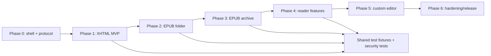

# XHTML Reader Previewer — Implementation Plan

## Ringkasan Eksekusi

Bangun ekstensi secara bertahap dengan satu reader webview dan satu protokol pesan tervalidasi. Mulai dari XHTML folder yang aman, lalu tambahkan parsing EPUB folder, EPUB archive, fitur reader, dan custom editor. Ini menjaga jalur debug tetap pendek serta menghindari dua renderer yang berbeda untuk split dan tab.

## Prinsip Implementasi

- Semua filesystem di extension host menggunakan `vscode.workspace.fs`; jangan memakai `fs` langsung untuk sumber workspace.
- Semua boundary (XHTML, XML OPF/nav, ZIP, dan pesan webview) dianggap data tidak tepercaya.
- Satu `ReaderSession` per panel dan satu `ReaderDocument` per sumber.
- `WebviewPanel` adalah fondasi UI awal; custom editor hanya adaptor tambahan di fase 5.
- Fitur dibangun dengan fixture kecil yang legal dan deterministik, bukan EPUB produksi besar.

## Prasyarat dan Dependensi

| Area | Pilihan | Catatan |
| --- | --- | --- |
| Runtime | TypeScript + VS Code Extension API | Gunakan rentang engine VS Code yang masih didukung saat bootstrap. |
| Bundling | `esbuild` | Dua entry point: extension host dan webview. |
| XML | parser XML ber-mode ketat | Jangan memakai parser yang mengeksekusi entity/DTD eksternal. |
| ZIP | library ZIP yang mendukung inspection/batas entry | Harus dapat menolak ZIP bomb dan path traversal. |
| Sanitasi | DOM parser + sanitizer yang dikonfigurasi ketat | URL/CSS tetap diverifikasi host, bukan hanya sanitizer. |
| Validasi | Zod/Valibot atau skema TypeScript runtime setara | Wajib pada protocol messages dan preference. |
| Test | Vitest/Jest + `@vscode/test-electron` | Pisahkan unit test host/parser dan integration test panel. |

Sebelum memilih library, lakukan proof-of-concept kecil untuk XML dan ZIP terhadap fixture malicious. Jangan mengadopsi library parser yang membawa dependency browser besar ke extension host tanpa alasan.

## Phase 0 — Bootstrap dan Kontrak Dasar

**Tujuan:** ekstensi dapat dibangun, di-debug, dan membuka panel reader kosong dengan CSP yang ketat.

1. Inisialisasi `package.json`, TypeScript strict, lint, format, dan build dua bundle.
2. Daftarkan command `xhtmlReader.openPreview` dan `xhtmlReader.openSplitPreview`.
3. Implementasikan `ReaderPanelManager` dan HTML shell dengan nonce, CSP, serta `localResourceRoots: []`.
4. Definisikan `HostToViewMessage`, `ViewToHostMessage`, `ReaderPreferences`, dan validator runtime.
5. Tambahkan README singkat: cakupan eksperimen, command, dan cara debug webview.

**Selesai bila:** command membuka panel bertajuk reader, CSP tidak memakai wildcard/`unsafe-eval`, dan test protocol menolak pesan tidak valid.

## Phase 1 — MVP XHTML Mandiri

**Tujuan:** preview XHTML mandiri dalam split maupun tab, dengan live reload dasar.

1. Tambahkan command Explorer/editor context untuk `.xhtml`, `.html`, dan `.htm`.
2. Implementasikan `StandaloneDocument` dengan pembacaan `workspace.fs.readFile`, encoding handling, dan base URI.
3. Buat `Sanitizer` untuk struktur HTML/XHTML serta `ResourceResolver` untuk `img`, `link[rel=stylesheet]`, `source`, dan font lokal.
4. Webview menerima `chapterLoaded`, merender HTML yang sudah disanitasi, dan menerapkan CSS reader dasar.
5. Tambahkan tema light/dark/sepia, ukuran font, line-height, content width, serta mode scroll.
6. Tambahkan `FileSystemWatcher` ter-*debounce* untuk dokumen dan resource yang direferensikan.
7. Saat reload, simpan anchor `id`/scroll ratio dan pulihkan jika node masih ada.

**Smoke test manual:** buka XHTML dengan gambar dan stylesheet relatif, edit judul, edit CSS, lalu pastikan preview memperbarui tanpa membuka URL jaringan.

**Selesai bila:** seluruh acceptance criteria XHTML nomor 1, 4 (mode scroll), 6 untuk XHTML, dan 7 dapat dibuktikan.

## Phase 2 — EPUB Folder dan Model Publikasi

**Tujuan:** membaca EPUB 3 ter-ekstrak sesuai struktur container/package, bukan berdasarkan asumsi nama berkas.

1. Implementasikan `EpubLocator` untuk menemukan dan parse `META-INF/container.xml`.
2. Implementasikan `OpfParser` untuk metadata dasar, manifest, spine, `properties`, `linear`, rendition property, dan path canonical.
3. Validasi setiap `idref` spine terhadap manifest; berikan diagnostics pengguna, bukan exception tak tertangani.
4. Implementasikan `NavigationParser` untuk navigation document XHTML dari item manifest berproperti `nav`, yang berisi `toc`; tambahkan fallback `toc.ncx` hanya sebagai kompatibilitas untuk publikasi lama/non-konforman.
5. Ubah `ReaderSession` agar lazy-load `SpineItem` lewat `loadChapter(index)`.
6. Tambahkan side navigation dalam webview: cover/title, daftar isi tree, previous/next, dan indikator chapter.
7. Perluas watcher ke `container.xml`, OPF, nav document, XHTML spine, stylesheet, dan gambar di folder publikasi.

**Fixture minimum:** EPUB 3 folder berisi `META-INF/container.xml`, OPF, nav, dua chapter XHTML, CSS, image, intra-link, cross-chapter link, dan footnote.

**Selesai bila:** fixture dibuka dari folder, TOC bekerja, spine berikutnya/sebelumnya bekerja, dan perubahan OPF/nav memuat ulang model dengan error yang dapat dimengerti.

## Phase 3 — EPUB Archive dan Resource Cache Aman

**Tujuan:** membuka `.epub` tanpa mengekstraknya ke workspace.

1. Implementasikan `ArchiveReader` di atas library ZIP yang dipilih: listing entry, lookup normalisasi, byte reading, dan content type hint.
2. Terapkan guard sebelum akses entry: maksimum jumlah entry, ukuran file/total uncompressed, rasio kompresi, panjang path, entry duplikat, NUL, traversal, dan symlink.
3. Buat `EpubCache` content-addressed di `context.storageUri`, dengan root spesifik buku dan kuota LRU.
4. Jadikan resolver menulis hanya aset yang diperlukan (chapter/CSS/image/font aktif) ke cache dan menyajikannya via `asWebviewUri`.
5. Pastikan membersihkan cache tidak menghapus berkas pengguna serta aman jika panel ditutup saat load berlangsung.
6. Buat fixture ZIP normal dan fixture ZIP bomb/traversal untuk negative test.

**Selesai bila:** `.epub` fixture memuat konten yang sama seperti folder fixture; ZIP malicious ditolak sebelum alokasi berlebihan dan dengan error yang informatif.

## Phase 4 — Reader Experience EPUB

**Tujuan:** pengalaman baca setara reader dasar modern untuk publikasi reflowable.

1. Implementasikan mode `paginated` berbasis CSS columns; buat controller next/previous halaman sebelum berpindah spine.
2. Buat `ReadingLocation` dengan prioritas `id`/selector, text offset, lalu scroll ratio fallback.
3. Persist location dan preferences lewat `workspaceState` dengan schema version dan key hash URI sumber.
4. Tangani link: fragment lokal, href antar-spine, link TOC, dan external URL melalui konfirmasi pengguna.
5. Tambahkan deteksi/penanganan footnote (`epub:type=noteref`, target footnote/asides) memakai popover accessible; fallback ke anchor.
6. Tambahkan keyboard bindings: next/previous page, next/previous chapter, toggle navigation, escape popover.
7. Uji resize, perubahan font, reload, dan dua panel membuka buku yang sama.

**Selesai bila:** reader menyimpan lokasi, mengembalikan user ke posisi masuk akal setelah reflow, dan semua jenis link pada fixture berjalan sesuai spesifikasi.

## Phase 5 — Integrasi Editor dan Kompatibilitas

**Tujuan:** meningkatkan workflow editing tanpa memecah core reader.

1. Tambahkan `CustomTextEditorProvider` untuk `.xhtml` sebagai opsi “Reopen With: XHTML Reader Previewer”.
2. Provider membagikan `ReaderSession`/renderer yang sama; dokumen teks VS Code menjadi sumber pembaruan untuk tab custom editor.
3. Jika `CustomTextEditorProvider` berbeda perilaku di Antigravity, fallback command split tetap didukung dan didokumentasikan.
4. Audit semua akses file agar remote workspace memakai `workspace.fs` dan URI, bukan path disk.
5. Lakukan smoke matrix: VS Code desktop, workspace lokal; lalu Antigravity, dan satu remote workspace jika tersedia.

**Selesai bila:** user dapat membuka split preview dari command walau custom editor tidak tersedia; fungsionalitas tidak regress pada WebviewPanel.

## Phase 6 — Hardening dan Rilis

**Tujuan:** keamanan, performa, dan operasional siap rilis beta.

1. Audit CSP, sanitizer, resource resolver, ZIP guard, dan protocol schema terhadap checklist security.
2. Tambahkan telemetry **opt-in hanya bila benar-benar diperlukan**; jangan mengirim judul buku, path, konten, atau URL sumber.
3. Tambahkan command diagnostics yang hanya menampilkan data teknis non-sensitif: tipe sumber, chapter aktif, parser warning, dan status watcher.
4. Dokumentasikan supported/unsupported EPUB features, batas archive, keyboard shortcuts, serta known issues.
5. Buat release checklist dan extension packaging CI.

## Urutan Teknis yang Disarankan

Jangan mulai ZIP archive sebelum folder EPUB stabil: keduanya memakai OPF, nav, spine, resolver, dan renderer yang sama; archive hanya mengganti layer resource source.

## Rencana Pengujian

### Unit

- XML container/OPF/nav: valid, missing, malformed, duplicate id, missing manifest target, bad encoding.
- Resource resolver: relative path, fragment, percent-encoding, path traversal, absolute URI, external URL, CSS `url()` dan `@import`.
- ZIP guard: oversized archive, too many entries, suspicious compression ratio, duplicate path, `../`, NUL, symlink.
- Sanitizer: `<script>`, `onclick`, iframe, external CSS, data URI policy, malformed XHTML, safe semantic EPUB elements.
- Reading location: id target, deleted target fallback, reflow after font setting change.
- Protocol validator: unknown message, wrong session, oversize fields, invalid index/preference.

### Integration

- Aktivasi extension dan command contribution.
- `WebviewPanel` menerima model dan meminta chapter berikutnya.
- Watcher melakukan reload ter-*debounce* dan tidak loop karena perubahan cache.
- Persist/restore panel state dan reading state.
- Custom editor (fase 5) membuka lalu mencerminkan edit dokumen teks.

### End-to-end manual

| Kasus | Ekspektasi |
| --- | --- |
| XHTML local + CSS/image | Render benar dalam tab dan split. |
| EPUB folder fixture | Metadata, TOC, dua chapter, dan links bekerja. |
| EPUB archive fixture | Sama dengan folder, tanpa output ke workspace. |
| Document malicious | Tidak ada script/fetch; UI menampilkan error aman. |
| Resize + pagination | Anchor tetap dekat posisi sebelumnya. |
| Live edits | Perubahan konten/style terlihat setelah debounce. |
| Antigravity smoke test | Command, panel, asset URI, dan watcher diuji; gap dicatat. |

## Acceptance Gate per Fase

| Gate | Bukti minimum |
| --- | --- |
| MVP XHTML | Unit resolver/sanitizer lulus; smoke tab + split + reload lulus. |
| EPUB folder | Fixture parsers lulus; TOC/spine/link manual lulus. |
| EPUB archive | Negative ZIP tests lulus; tidak ada file workspace baru. |
| Reader beta | Location, pagination, footnotes, keyboard, accessibility smoke lulus. |
| Release candidate | Full test suite, CSP/security review, compatibility matrix, docs rilis. |

## Risiko dan Mitigasi

| Risiko | Dampak | Mitigasi |
| --- | --- | --- |
| XHTML publikasi tidak valid | Render gagal/berbeda | XML-first, fallback terkontrol, error actionable, fixture nyata. |
| ZIP bomb/path traversal | Resource exhaustion/akses luar cache | Limit sebelum extract, normalisasi path, cache isolated. |
| Asset relative kompleks | Gambar/CSS hilang | Resolver tunggal untuk semua source dan test matrix URI. |
| Pagination CSS tidak stabil | Lokasi baca lompat | Simpan anchor semantik, bukan page number; scroll tetap fallback. |
| Webview XSS | Eksekusi konten buku | CSP strict, sanitizer, no remote content, protocol allowlist. |
| API Antigravity berbeda | Fitur tidak muncul | Core hanya memakai API VS Code umum; fallback command; smoke test per versi. |
| EPUB fixed-layout/JS-heavy | Harapan user tidak terpenuhi | Nyatakan reflowable-only pada beta dan deteksi/beri warning. |
| File watcher bising | Reload berulang | Debounce, filter source map, abaikan cache extension. |

## Definition of Done untuk Beta

- Semua kriteria penerimaan dalam `spec.md` dapat direproduksi memakai fixture dan langkah manual terdokumentasi.
- Tidak ada `unsafe-eval`, remote fetch, atau direct workspace path traversal pada implementation review.
- Kegagalan OPF/XHTML/ZIP ditampilkan sebagai UI error, tidak membuat extension host crash.
- README mencantumkan instruksi install, command, batas EPUB, privacy/security posture, dan compatibility note untuk Antigravity.
- Paket extension dapat dibangun dari clean checkout dan semua test otomatis target berjalan di CI.

## Catatan Referensi

Rancangan ini mengacu pada Webview/Custom Editor/Extension API VS Code dan spesifikasi EPUB 3.3, EPUB Reading Systems 3.3, serta EPUB Open Container Format 3.3. URL primer dan keputusan desain terkait tersedia di `spec.md`.
