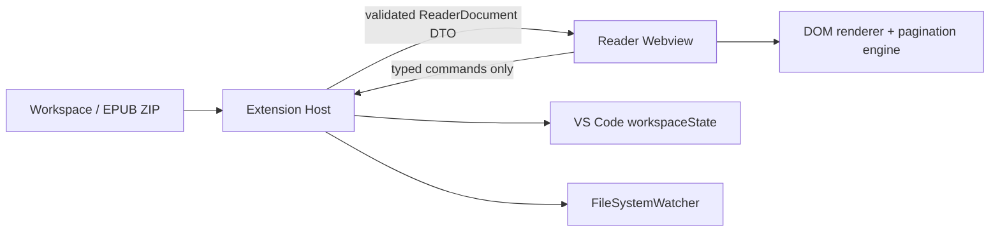

# XHTML Reader Previewer — Technical Specification

## 1. Ringkasan

**XHTML Reader Previewer** adalah ekstensi berbasis VS Code Extension API untuk membaca dan mem-preview:

- file XHTML mandiri (`.xhtml`, `.html`, `.htm`), dan
- publikasi EPUB yang tersedia sebagai folder ter-ekstrak atau arsip `.epub`.

Ekstensi menyajikan pengalaman reader yang terinspirasi pembaca EPUB modern: mode gelap/terang/sepia, kontrol tipografi, tampilan *scroll* atau halaman, daftar isi, tautan internal, catatan kaki, resolusi aset lokal, dan pembaruan langsung saat berkas berubah.

Target utama adalah VS Code desktop. Antigravity IDE didukung **sejauh API kompatibel dengan VS Code**—tidak ada ketergantungan pada API vendor khusus.

## 2. Tujuan dan Batasan

### Tujuan

1. Membuka XHTML mandiri dan isi EPUB tanpa mengubah dokumen sumber.
2. Menawarkan dua cara membuka reader:
   - **split editor–preview**, melalui custom editor yang diposisikan di samping editor teks; dan
   - **tab reader terpisah**, melalui `WebviewPanel`.
3. Menjaga posisi baca serta preferensi pembaca per dokumen/workspace.
4. Merefleksikan perubahan berkas dengan cepat dan aman.
5. Mendukung inti EPUB 3: container, package/OPF, manifest, spine, navigation document, XHTML content document, dan resource lokal.

### Non-goals versi 1

- DRM, Adobe RMSDK, LCP, atau buku terenkripsi.
- Sinkronisasi cloud, anotasi kolaboratif, TTS, audiobook, dan pencarian full-text lintas buku.
- Eksekusi JavaScript, form submission, atau jaringan dari konten buku.
- Layout fixed-layout EPUB dan media overlays. Buku reflowable adalah fokus utama.

## 3. Pengalaman Pengguna

| Skenario | Hasil |
| --- | --- |
| Membuka `chapter.xhtml` | Reader menampilkan konten dan aset relatif dari direktori file. |
| Membuka folder EPUB | Ekstensi mencari `META-INF/container.xml`, memuat rootfile OPF, lalu membuka spine pertama. |
| Membuka `book.epub` | Ekstensi membaca ZIP secara defensif ke model memori/cache, tanpa mengekstrak ke workspace. |
| Menekan `Open Reader Preview` | Membuka panel reader terpisah pada kolom editor aktif/di sampingnya. |
| Menekan `Open Split Preview` | Membuka reader di editor group di samping editor teks. |
| Mengubah XHTML/CSS/gambar | Preview aktif dimuat ulang atau di-*patch* dengan lokasi baca yang dipulihkan bila aman. |
| Mengikuti referensi `#note-3` | Reader menggulir/memindahkan halaman ke target; tautan footnote membuka popover bila target adalah catatan kaki. |

## 4. Keputusan Arsitektur

### 4.1 Pemisahan host dan webview

Ekstensi terdiri dari dua batas kepercayaan.



**Extension Host** adalah sumber kebenaran untuk akses berkas, parsing EPUB, izin URI, penyimpanan state, dan file watching. **Webview** hanya merender DTO yang telah dinormalisasi serta meminta aksi melalui protokol pesan bertipe.

Kebijakan ini meminimalkan akses webview terhadap filesystem dan memudahkan portabilitas ke IDE yang kompatibel.

### 4.2 Mode UI

| Mode | Implementasi | Kapan dipakai |
| --- | --- | --- |
| Tab reader | `vscode.window.createWebviewPanel` | Membaca nyaman, navigasi antar-bab, EPUB arsip. |
| Split | Perintah membuka panel di `ViewColumn.Beside`; opsional custom editor untuk `.xhtml` | Menulis XHTML sambil melihat hasil. |
| Custom editor (opsional fase lanjut) | `vscode.CustomTextEditorProvider` untuk XHTML | Integrasi “Reopen With” dan split yang terasa native. |

MVP memakai `WebviewPanel` untuk kedua mode supaya satu renderer dan satu protokol dipakai bersama. Custom editor ditambahkan setelah perilaku preview stabil; ia mengirim dokumen teks yang sama ke renderer, bukan menduplikasi engine.

### 4.3 Model dokumen terpadu

```ts
type ReaderSource =
  | { kind: 'standalone'; documentUri: string; baseUri: string }
  | { kind: 'epubFolder'; rootUri: string; opfUri: string }
  | { kind: 'epubArchive'; archiveUri: string; packagePath: string };

interface ReaderDocument {
  id: string;
  source: ReaderSource;
  metadata: { title: string; language?: string; creator?: string[]; direction?: 'ltr' | 'rtl' };
  spine: SpineItem[];
  navigation: NavigationEntry[];
  rendition: { layout: 'reflowable'; spread: 'auto' | 'none'; writingMode?: string };
}

interface SpineItem {
  idref: string;
  href: string;
  mediaType: 'application/xhtml+xml' | 'text/html' | string;
  linear: boolean;
}
```

`ReaderDocument` tidak memuat byte aset atau HTML mentah untuk seluruh buku sekaligus. Host memuat satu spine item pada permintaan, memvalidasi dan menormalisasi referensi, lalu mengirim `ChapterPayload` ke panel.

## 5. Struktur Proyek yang Disarankan

```text
xhtml-reader-previewer/
├─ package.json
├─ tsconfig.json
├─ esbuild.mjs
├─ src/
│  ├─ extension.ts                 # activate, commands, registrasi provider
│  ├─ commands/
│  │  ├─ openReader.ts
│  │  └─ openSplitPreview.ts
│  ├─ readers/
│  │  ├─ ReaderPanelManager.ts
│  │  ├─ ReaderSession.ts
│  │  └─ CustomXhtmlEditorProvider.ts
│  ├─ epub/
│  │  ├─ EpubLocator.ts            # container.xml / OPF discovery
│  │  ├─ OpfParser.ts
│  │  ├─ NavigationParser.ts
│  │  ├─ ArchiveReader.ts
│  │  └─ ResourceResolver.ts
│  ├─ xhtml/
│  │  ├─ StandaloneDocument.ts
│  │  └─ Sanitizer.ts
│  ├─ protocol/
│  │  ├─ messages.ts
│  │  └─ schemas.ts
│  ├─ state/
│  │  └─ ReadingStateStore.ts
│  └─ watchers/
│     └─ SourceWatcher.ts
├─ webview/
│  ├─ src/
│  │  ├─ main.ts
│  │  ├─ app/ReaderApp.ts
│  │  ├─ renderer/ChapterRenderer.ts
│  │  ├─ renderer/ResourceMapper.ts
│  │  ├─ layout/PaginationEngine.ts
│  │  ├─ navigation/NavigationController.ts
│  │  ├─ footnotes/FootnotePopover.ts
│  │  ├─ settings/ReaderPreferences.ts
│  │  └─ protocol/client.ts
│  └─ styles/
│     ├─ reader.css
│     └─ themes.css
├─ test/
│  ├─ unit/
│  ├─ fixtures/epub3/
│  └─ integration/
└─ docs/
```

Bangun `src/` dan `webview/` sebagai bundle terpisah. Kode webview tidak boleh mengimpor `vscode`; gunakan `acquireVsCodeApi()` hanya pada adaptor `protocol/client.ts`.

## 6. Komponen dan Kontrak

### 6.1 Extension Host

| Komponen | Tanggung jawab |
| --- | --- |
| `ReaderPanelManager` | Lifecycle panel, restore session, routing pesan, dan disposal. |
| `ReaderSession` | Menyimpan sumber aktif, chapter, lokasi, preferensi efektif, dan watcher. |
| `EpubLocator` | Menemukan OPF dari `META-INF/container.xml`, bukan menebak nama berkas. |
| `OpfParser` | Memvalidasi manifest/spine dan metadata minimal. |
| `NavigationParser` | Membaca navigation document EPUB 3; fallback terbatas ke `toc.ncx` bila disediakan. |
| `ResourceResolver` | Mengubah referensi relatif menjadi URI webview yang diizinkan. |
| `SourceWatcher` | Memonitor XHTML/CSS/OPF/nav serta sumber folder; debounce dan mengirim invalidasi. |
| `ReadingStateStore` | Menyimpan lokasi dan preference menggunakan `workspaceState`; key di-hash dari URI sumber. |

### 6.2 Protokol pesan

Semua pesan diberi `sessionId`, `version`, dan divalidasi dengan skema runtime sebelum diproses.

| Arah | Pesan | Payload utama |
| --- | --- | --- |
| host → view | `documentReady` | metadata, spine ringkas, nav, preference |
| host → view | `chapterLoaded` | index, canonical href, XHTML ter-sanitasi, resource map |
| host → view | `sourceInvalidated` | jenis perubahan dan daftar URI |
| view → host | `loadChapter` | index dan fragment opsional |
| view → host | `resolveLink` | href sumber dan chapter saat ini |
| view → host | `saveReadingLocation` | anchor `id`/selector, text offset, scroll ratio fallback |
| view → host | `updatePreferences` | patch preference tervalidasi |
| view → host | `requestOpenExternal` | URL `https:` yang telah mendapat konfirmasi pengguna |

Tidak ada pesan generik seperti `executeCommand`, `readFile`, atau payload JavaScript.

## 7. Alur Data

### 7.1 XHTML mandiri

1. Command menerima URI aktif atau URI dari Explorer.
2. `StandaloneDocument` membaca XHTML sebagai UTF-8 (deteksi deklarasi XML bila perlu) dan memilih `baseUri` sebagai direktori induk.
3. Host membangun `ChapterPayload`, melakukan sanitasi, dan membuat peta setiap resource yang berhasil diotorisasi.
4. Webview mengganti konten chapter, memasang handler link, menerapkan tema, lalu memulihkan lokasi baca.
5. Watcher pada file XHTML dan aset/CSS yang direferensikan memicu invalidasi ter-*debounce*.

### 7.2 EPUB folder/arsip

1. Untuk folder, host membaca `META-INF/container.xml`. Untuk `.epub`, `ArchiveReader` membaca entri ZIP dan memberlakukan batas ukuran/jumlah entri.
2. `EpubLocator` mendapat rootfile OPF; `OpfParser` membuat manifest map dan spine terurut.
3. `NavigationParser` memuat item manifest bertipe `nav` dan menghasilkan tree daftar isi.
4. Host mengirim metadata/daftar isi, lalu chapter pertama linear ke webview.
5. Perpindahan bab hanya meminta chapter yang diperlukan. Aset chapter disajikan melalui URI yang dipetakan oleh host.

### 7.3 Resolusi link

1. Webview mencegat setiap klik `<a>`.
2. Fragment lokal (`#id`) dicari di chapter; untuk semantik footnote, buka popover terlebih dahulu.
3. Href menuju item manifest atau XHTML relatif dikirim sebagai `resolveLink`; host melakukan normalisasi POSIX, menolak traversal, lalu mengembalikan spine index/fragment.
4. `mailto:`, `tel:`, dan skema non-HTTP diblokir. `https:` hanya dapat dibuka lewat `vscode.env.openExternal` setelah konfirmasi eksplisit.

## 8. Rendering dan Fitur Reader

### 8.1 Sanitasi XHTML

Sebelum disuntikkan ke DOM reader:

- parse sebagai XML/XHTML sejauh mungkin; fallback HTML parser dengan peringatan bila malformed;
- hapus `script`, event handler inline (`on*`), `iframe`, `object`, `embed`, `form`, dan `base`;
- buang CSS berbahaya/eksternal seperti `url(http...)`, `@import`, dan perilaku yang mengizinkan jaringan;
- pertahankan elemen semantik EPUB/XHTML, `id`, `class`, `epub:type`, gambar lokal, dan stylesheet lokal yang telah dipetakan;
- tampilkan error terarah bila XHTML tidak dapat dirender, beserta tombol membuka sumber di editor teks.

Sanitasi bukan pengganti CSP; keduanya wajib.

### 8.2 Tipografi dan tema

Preference tersimpan per workspace dan dapat dioverride per sesi:

- `theme`: `system | light | dark | sepia`
- `fontFamily`: system serif, system sans, atau font workspace yang eksplisit diizinkan
- `fontSize`: 12–32 px
- `lineHeight`: 1.2–2.4
- `contentWidth`: 38–90 ch
- `paragraphSpacing`: 0–2 em
- `mode`: `scroll | paginated`

Gunakan CSS custom properties untuk seluruh setting agar perubahan tidak perlu mem-parsing ulang chapter.

### 8.3 Pagination dan posisi baca

MVP default adalah scroll. Mode paginated menggunakan container berkolom CSS (`column-width`/`column-gap`) dengan viewport satu atau dua halaman bergantung lebar dan preference. Engine menyimpan:

1. selector stabil atau `id` target bila tersedia;
2. offset teks relatif bila selector ditemukan;
3. rasio scroll sebagai fallback.

Pada resize atau perubahan font, engine menghitung ulang halaman dan memulihkan anchor, bukan nomor halaman absolut. Nomor halaman selalu merupakan estimasi tampilan, bukan pagination canonical EPUB.

### 8.4 Navigasi, footnote, dan arah tulis

- Daftar isi dibangun dari EPUB nav document atau heading XHTML yang tersedia.
- Tombol previous/next menggunakan urutan spine dan mengabaikan item non-linear secara default.
- Tautan dengan `epub:type="noteref"`, backlink, atau target dalam `aside[epub|role~="footnote"]` ditampilkan dalam popover; fallback-nya adalah navigasi ke anchor.
- Terapkan `dir` dari package/content document dan hormati `writing-mode` CSS sepanjang browser webview mendukungnya. RTL masuk tahap kompatibilitas khusus, bukan kriteria MVP.

## 9. Resource Resolution

### Sumber folder/XHTML

`ResourceResolver` menerima URI relatif, menormalisasikannya terhadap URI chapter, memastikan target tetap berada di root yang diizinkan, lalu mengubahnya dengan `webview.asWebviewUri`. `localResourceRoots` hanya mencakup media ekstensi yang dibundel dan:

- direktori dokumen XHTML mandiri, atau
- root EPUB folder dan direktori storage/cache extension yang spesifik sesi.

### Sumber `.epub`

Webview tidak boleh menerima akses ZIP langsung. Host membuka byte entry yang telah divalidasi dan menulis cache content-addressed ke `context.storageUri/epub-cache/<book-hash>/`; URI cache itu yang dipetakan ke `asWebviewUri`. Cache dibersihkan dengan kuota LRU saat aktivasi/dispose, tidak pernah ke workspace pengguna.

Aturan resolver:

- Tolak path absolut, `..` setelah normalisasi, NUL, dan skema selain sumber internal yang dipetakan.
- Izinkan hanya media type/rangkaian ekstensi yang dirender (`xhtml/html`, CSS, image/font/audio lokal pada fase berikutnya).
- Ukur ukuran berkas sebelum mengirim dan batasi aset besar.
- Jangan gunakan URI eksternal sebagai `src`, `href`, `@import`, atau `url()`.

## 10. Keamanan Webview

1. Tetapkan `enableScripts: false` bila renderer bisa berjalan tanpa script di dokumen. Karena UI reader interaktif memerlukan bundle script, panel reader menetapkan `enableScripts: true`; konten buku tetap disuntikkan sebagai data ter-sanitasi, bukan dokumen webview penuh.
2. Gunakan `localResourceRoots` minimal dan `asWebviewUri` untuk setiap sumber lokal.
3. Bangun CSP ketat dengan nonce unik per render: `default-src 'none'; img-src ${webview.cspSource} data:; style-src ${webview.cspSource} 'nonce-…'; font-src ${webview.cspSource}; script-src 'nonce-…'; connect-src 'none'; media-src ${webview.cspSource}`. Hindari `unsafe-eval` dan `unsafe-inline` untuk script.
4. Jangan memasukkan nilai sumber yang belum dipercaya ke HTML template, atribut, CSS, atau `innerHTML` tanpa sanitasi/escaping bertipe konteks.
5. Validasi ukuran, tipe, dan skema untuk setiap pesan webview; abaikan pesan dari panel/sesi yang sudah dispose.
6. Jangan memuat remote content dan jangan memperlakukan XHTML sebagai trusted workspace code.
7. Batasi ZIP: maksimum entry, ukuran terkompresi/tak-terkompresi, rasio kompresi, kedalaman path, serta tolak entri duplikat dan symlink.

## 11. Konfigurasi dan Perintah

| ID | Fungsi |
| --- | --- |
| `xhtmlReader.openPreview` | Membuka reader pada tab terpisah. |
| `xhtmlReader.openSplitPreview` | Membuka reader di kolom sebelah. |
| `xhtmlReader.revealActiveSource` | Memilih posisi reader sesuai file/editor aktif. |
| `xhtmlReader.toggleLayout` | Mengubah scroll/paginated. |
| `xhtmlReader.resetReadingState` | Menghapus lokasi tersimpan untuk sumber aktif. |

Konfigurasi `xhtmlReader`:

- `defaultTheme`, `defaultLayout`, `defaultFontSize`, `defaultLineHeight`, `defaultContentWidth`
- `livePreview`: boolean, default `true`
- `livePreviewDebounceMs`: 150–2000, default `350`
- `epub.maxArchiveUncompressedMb`: default `250`
- `epub.maxEntryCount`: default `10_000`

## 12. Kompatibilitas

| Lingkungan | Status | Catatan |
| --- | --- | --- |
| VS Code desktop terbaru | Target penuh | Mengandalkan webview, filesystem, command, watcher, dan state API. |
| VS Code web | Best effort | ZIP/cache dan filesystem URI perlu adaptor; jangan dijadikan dukungan resmi pada MVP. |
| Antigravity IDE | Best effort | Berfungsi bila mendukung API VS Code untuk `WebviewPanel`, URI, watcher, command, dan state. Uji smoke test per rilis IDE. |
| Remote SSH/WSL/Containers | Target setelah MVP | Semua akses melalui `vscode.workspace.fs`, bukan Node `fs` langsung. |

Hindari Node API yang langsung mengasumsikan disk lokal untuk jalur EPUB folder; gunakan `vscode.workspace.fs` di boundary host. `ArchiveReader` dapat memakai buffer yang diperoleh dari API tersebut.

## 13. Kinerja dan Ketahanan

- Muat satu chapter dan aset yang terlihat; jangan merender seluruh spine ke satu DOM.
- Debounce perubahan, batalkan render yang kalah dengan `AbortController`/request id, dan pertahankan chapter lama bila parse baru gagal.
- Cache parse OPF/nav berdasarkan mtime/hash. Invalidasi saat OPF/manifest/nav berubah.
- Tampilkan indikator loading untuk chapter >100 ms dan error panel yang dapat ditutup untuk kegagalan resource individual.
- Pertahankan batas DOM/asset dan berikan pesan jelas untuk EPUB yang melebihi kebijakan keamanan.

## 14. Kriteria Penerimaan Produk

1. File XHTML lokal dengan CSS dan gambar relatif dapat dibaca dalam tab maupun split, tanpa akses jaringan.
2. EPUB 3 folder yang valid dengan `container.xml`, OPF, nav, dan dua XHTML spine item dapat dibuka, dinavigasi, dan direload.
3. Arsip `.epub` yang sama dapat dibuka tanpa diekstrak ke workspace dan menolak ZIP bomb fixture secara aman.
4. Tema, ukuran font, lebar konten, serta scroll/pagination memperbarui reader tanpa kehilangan chapter aktif.
5. Tautan intra-bab, antar-bab, dan footnote bekerja; tautan eksternal tidak dibuka diam-diam.
6. Mengubah XHTML/CSS/OPF folder memicu preview update ter-*debounce* serta mempertahankan anchor bila mungkin.
7. CSP dan sanitasi mencegah script/event handler/remote fetch dari fixture berbahaya.
8. Menutup dan membuka ulang panel memulihkan lokasi baca dan preference yang relevan.

## 15. Referensi Normatif dan API

- [VS Code Webview extension guide](https://code.visualstudio.com/api/extension-guides/webview): lifecycle, URI lokal, CSP, dan pertukaran pesan.
- [VS Code Custom Editors guide](https://code.visualstudio.com/api/extension-guides/custom-editors): model custom text editor dan integrasi editor.
- [VS Code Extension API reference](https://code.visualstudio.com/api/references/vscode-api): `WebviewPanel`, `Webview`, `workspace.fs`, `FileSystemWatcher`, dan memento state.
- [EPUB 3.3](https://www.w3.org/TR/epub-33/): publication resources, package document, manifest, spine, navigation, dan content documents.
- [EPUB Reading Systems 3.3](https://www.w3.org/TR/epub-rs-33/): perilaku reader dan pemrosesan publikasi.
- [EPUB Open Container Format 3.3](https://www.w3.org/TR/epub-ocf-33/): `container.xml` dan container ZIP EPUB.

Untuk detail yang menjadi batas desain, lihat langsung [resource lokal dan URI webview](https://code.visualstudio.com/api/extension-guides/webview#loading-local-content), [security webview](https://code.visualstudio.com/api/extension-guides/webview#security), [lifecycle custom text editor](https://code.visualstudio.com/api/extension-guides/custom-editors#custom-text-editor-lifecycle), [manifest/spine EPUB](https://www.w3.org/TR/epub-33/#sec-package-documents), [navigation document](https://www.w3.org/TR/epub-33/#sec-nav), serta [scripting dan security EPUB](https://www.w3.org/TR/epub-33/#sec-security-privacy).

Referensi ini harus diverifikasi kembali ketika dependensi atau target VS Code diperbarui.
