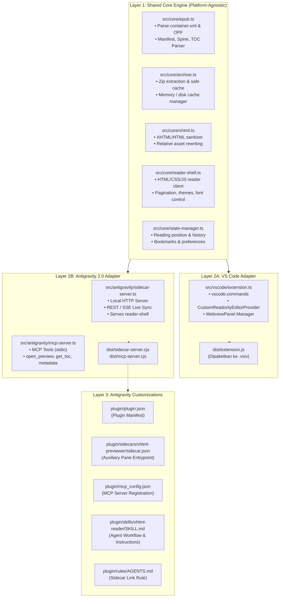

# Antigravity 2.0 Plugin & Dual-Target Architecture — Technical Specification

## 1. Ringkasan Eksekutif

Spesifikasi teknis ini mendefinisikan arsitektur **Dual-Target** untuk proyek **XHTML Reader Previewer**. Sistem ini memungkinkan satu basis kode (*codebase*) terpadu untuk mendistribusikan dua artefak perangkat lunak yang berbeda:

1. **VS Code Extension (`.vsix`)**: Ekstensi editor konvensional untuk VS Code dan IDE turunannya yang menyajikan pembaca XHTML/EPUB di tab editor (`WebviewPanel` / `CustomEditorProvider`).
2. **Antigravity 2.0 Plugin (`/plugin`)**: Paket kustomisasi *AI-native* untuk Google Antigravity 2.0 yang menyajikan antarmuka pembaca di panel samping (*Auxiliary Pane*) via protokol `sidecar://` serta menyediakan perkakas cerdas untuk AI Agent melalui **Model Context Protocol (MCP)**.

---

## 2. Arsitektur Sistem Dual-Target

Sistem dibagi menjadi tiga lapisan (*layered architecture*) yang terisolasi dengan batas tanggung jawab yang tegas:



---

## 3. Spesifikasi Komponen

### 3.1 Shared Core Engine (`src/core/`)

Modul inti tidak boleh mengimpor modul `vscode` atau API spesifik IDE mana pun. Modul ini murni memanfaatkan Node.js standard runtime (`node:fs`, `node:path`, `node:os`, `node:buffer`, `node:crypto`).

* **`archive.ts`**: Menangani ekstraksi berkas `.epub` (arsip ZIP) ke direktori *cache* sementara yang aman. Mencegah kerentanan *Zip Slip* dan *symlink traversal*.
* **`epub.ts`**: Membaca `META-INF/container.xml`, mem-parsing berkas OPF (`content.opf`), mengurai urutan `<spine>`, daftar berkas `<manifest>`, dan pohon navigasi `<nav>`/NCX.
* **`xhtml.ts`**: Membersihkan berkas konten XHTML, menyelesaikan path aset relatif (CSS, gambar, font), dan mengekstrak elemen spesifik (seperti ID catatan kaki).
* **`reader-shell.ts`**: Menghasilkan HTML, CSS, dan JavaScript sisi klien yang membentuk antarmuka pembaca buku interaktif. Antarmuka ini dapat dirender di dalam iframe webview VS Code maupun di dalam browser/Electron pane Antigravity.
* **`state-manager.ts`**: Menyimpan preferensi pengguna (tema, font-family, font-size, layout mode) dan riwayat posisi membaca. Memiliki abstraksi penyimpanan (*storage adapter*) sehingga dapat disimpan di `vscode.workspaceState` pada VS Code atau di berkas JSON lokal (`~/.xhtml-reader/state.json`) pada Antigravity.

---

### 3.2 Antigravity UI Sidecar (`src/antigravity/sidecar-server.ts`)

Sidecar Antigravity adalah proses mandiri yang dijalankan oleh runtime Antigravity 2.0 untuk menyajikan antarmuka visual di panel samping (*Auxiliary Pane*).

#### A. Mekanisme Port & Lifecycle
* Antigravity secara otomatis menentukan port acak dan menginjeksikannya melalui environment variable:
  ```typescript
  const port = parseInt(process.env.ANTIGRAVITY_SIDECAR_WEB_PORT || '5890', 10);
  const host = '127.0.0.1';
  ```
* Sidecar menjalankan server HTTP lokal ringan (`node:http` murni tanpa framework berat untuk menjaga jejak memori di bawah 30 MB).
* Server memantau sinyal `SIGINT` dan `SIGTERM` untuk melakukan *graceful shutdown* dan pembersihan cache.

#### B. API Endpoints Sidecar

| Method | Endpoint | Deskripsi |
| :--- | :--- | :--- |
| `GET` | `/` | Melayani HTML reader shell yang dihasilkan oleh `reader-shell.ts`. |
| `GET` | `/api/status` | Mengembalikan status dokumen yang sedang terbuka, lokasi membaca, dan metadata buku saat ini. |
| `POST` | `/api/open` | Menerima payload `{ filePath: string, spineIndex?: number, targetId?: string }` untuk memuat buku baru ke pembaca. |
| `GET` | `/api/events` | Stream Server-Sent Events (SSE) untuk memperbarui tampilan saat ada perubahan dokumen (live reload / hot reload). |
| `GET` | `/assets/*` | Endpoint penyaji aset statis lokal (gambar, font, css) dari direktori cache EPUB yang aman. |

#### C. Manifest Sidecar (`plugin/sidecars/xhtml-previewer/sidecar.json`)
```json
{
  "command": "node",
  "args": ["dist/sidecar-server.cjs"],
  "display_name": "XHTML & EPUB Reader",
  "description": "Interactive reader and previewer for XHTML and EPUB publications in the auxiliary pane.",
  "has_web_ui": true,
  "restart_policy": "always",
  "ui_config": {
    "display_name": "XHTML Reader",
    "views": [
      {
        "title": "XHTML Reader",
        "path": "/",
        "entrypoint": "SIDECAR_UI_ENTRYPOINT_AUX_PANE"
      }
    ]
  }
}
```

---

### 3.3 Antigravity MCP Server (`src/antigravity/mcp-server.ts`)

Server Model Context Protocol (MCP) menghubungkan pembaca buku dengan kecerdasan AI Agent di Antigravity melalui antarmuka `stdio`.

#### A. Konfigurasi Plugin (`plugin/mcp_config.json`)
```json
{
  "mcpServers": {
    "xhtml_reader_mcp": {
      "command": "node",
      "args": ["dist/mcp-server.cjs"]
    }
  }
}
```

#### B. Skema Tools MCP

##### 1. `xhtml_open_preview`
* **Deskripsi**: Memuat berkas EPUB atau XHTML ke dalam Antigravity Auxiliary Pane reader dan membuka bab yang diminta.
* **Input Parameters**:
  ```json
  {
    "type": "object",
    "properties": {
      "filePath": { "type": "string", "description": "Absolute or workspace-relative path to the .epub, .xhtml, or .html file" },
      "spineIndex": { "type": "number", "description": "Optional 0-based spine chapter index to jump to" },
      "targetId": { "type": "string", "description": "Optional element anchor ID to focus on" }
    },
    "required": ["filePath"]
  }
  ```
* **Output**: Konfirmasi status dokumen berhasil dibuka, judul buku, total bab, dan URL sidecar yang aktif.

##### 2. `xhtml_get_toc`
* **Deskripsi**: Mengambil struktur daftar isi (TOC / Nav Doc) dari buku untuk dianalisis oleh AI Agent.
* **Input Parameters**:
  ```json
  {
    "type": "object",
    "properties": {
      "filePath": { "type": "string", "description": "Path to the .epub or .xhtml file" }
    },
    "required": ["filePath"]
  }
  ```
* **Output**: JSON terstruktur berisi daftar judul bab, level indentasi, dan path file target.

##### 3. `xhtml_get_metadata`
* **Deskripsi**: Mengambil informasi bibliografi buku (judul, pengarang, bahasa, identifier, cover image).
* **Input Parameters**:
  ```json
  {
    "type": "object",
    "properties": {
      "filePath": { "type": "string", "description": "Path to the .epub or .xhtml file" }
    },
    "required": ["filePath"]
  }
  ```

---

### 3.4 Agent Skill & Rule Integration

#### A. Skill Manifest (`plugin/skills/xhtml-reader/SKILL.md`)
Mengajarkan Agent kapan dan bagaimana memanggil previewer:
* **Pemicu**: Setiap kali pengguna mendiskusikan penulisan e-book, layout EPUB, dokumen XHTML, atau meminta pratinjau buku.
* **Pola Eksekusi**:
  1. Agent menggunakan `xhtml_open_preview` untuk memuat buku ke sidecar.
  2. Agent menyertakan pill tautan interaktif `sidecar://` pada pesan obrolan agar pengguna dapat membuka panel samping dalam 1 klik.

#### B. Rule (`plugin/rules/AGENTS.md`)
Memastikan Agent selalu memunculkan tautan auxiliary pane saat menangani berkas buku:
```markdown
# XHTML & EPUB Reader Presentation Rules

Whenever you analyze, edit, or discuss an `.epub`, `.xhtml`, or `.html` publication file:
1. Always offer the interactive reader sidecar view to the user.
2. Emit the sidecar navigation pill link in standard format:
   [Buka XHTML Reader](sidecar://xhtml-reader-plugin/xhtml-previewer/)
```

---

## 4. Struktur Direktori Repositori

```text
d:\Project\XHTML Reader Previewer\
├── package.json                          # Unified scripts & build configuration
├── tsconfig.json                         # Base TypeScript config
├── tsconfig.core.json                    # Compiler config for pure core (no vscode types)
│
├── src/
│   ├── core/                             # PLATFORM-AGNOSTIC CORE ENGINE
│   │   ├── archive.ts                    # Safe zip extraction & memory caching
│   │   ├── epub.ts                       # OPF, Spine, Manifest, & TOC parser
│   │   ├── xhtml.ts                      # Sanitizer & relative URL rewriter
│   │   ├── state-manager.ts              # Reading state & preferences manager
│   │   └── reader-shell.ts               # Client-side HTML/CSS/JS reader shell
│   │
│   ├── vscode/                           # VS CODE EXTENSION ADAPTER
│   │   └── extension.ts                  # VS Code entry point & CustomEditorProvider
│   │
│   └── antigravity/                      # ANTIGRAVITY 2.0 ADAPTER
│       ├── sidecar-server.ts             # Local HTTP Server for Auxiliary Pane
│       └── mcp-server.ts                 # MCP Server (stdio transport)
│
├── plugin/                               # ANTIGRAVITY PLUGIN DISTRIBUTION
│   ├── plugin.json                       # Antigravity Plugin manifest
│   ├── mcp_config.json                   # MCP Server registration
│   ├── assets/
│   │   └── logo.png                      # Plugin icon
│   ├── sidecars/
│   │   └── xhtml-previewer/
│   │       └── sidecar.json              # Sidecar aux pane declaration
│   ├── skills/
│   │   └── xhtml-reader/
│   │       └── SKILL.md                  # Agent skill documentation
│   └── rules/
│       └── AGENTS.md                     # Agent sidecar navigation rules
│
├── dist/                                 # COMPILED BUNDLES
│   ├── extension.js                      # VS Code Extension bundle (CJS)
│   ├── sidecar-server.cjs                # Antigravity Sidecar bundle (CJS)
│   └── mcp-server.cjs                    # Antigravity MCP Server bundle (CJS)
│
├── resource/
│   ├── notes/
│   │   ├── note-2026-11-14.md
│   │   ├── note-2026-11-16.md
│   │   └── note-2026-11-17.md            # Catatan keputusan arsitektur dual-target
│   └── specs/
│       ├── spec.md                       # Spesifikasi awal VS Code
│       ├── implementation-plan.md
│       └── antigravity-plugin-spec.md    # Dokumen spesifikasi ini
│
└── tasks/                                # TASK LIFECYCLE (Backlog / Active / Archive)
```

---

## 5. Build, Packaging, dan Distribusi

### 5.1 Pipeline Kompilasi (`package.json`)
```json
{
  "scripts": {
    "compile": "npm run build:all",
    "build:all": "npm run build:vscode && npm run build:antigravity",
    "build:vscode": "esbuild src/vscode/extension.ts --bundle --outfile=dist/extension.js --external:vscode --format=cjs --platform=node --sourcemap",
    "build:antigravity": "npm run build:sidecar && npm run build:mcp",
    "build:sidecar": "esbuild src/antigravity/sidecar-server.ts --bundle --outfile=dist/sidecar-server.cjs --format=cjs --platform=node --sourcemap",
    "build:mcp": "esbuild src/antigravity/mcp-server.ts --bundle --outfile=dist/mcp-server.cjs --format=cjs --platform=node --sourcemap",
    "package:vsix": "vsce package",
    "deploy:local-plugin": "node scripts/deploy-plugin-local.js"
  }
}
```

### 5.2 Strategi Distribusi
1. **VS Code**: `npm run package:vsix` menghasilkan `xhtml-reader-previewer-<version>.vsix` siap rilis ke Open VSX dan Visual Studio Marketplace.
2. **Antigravity 2.0**:
   - **Mode Proyek**: Salin folder `plugin/` ke direktori `.agents/plugins/xhtml-reader/` di dalam workspace manapun.
   - **Mode Global**: Salin ke `~/.gemini/config/plugins/xhtml-reader-plugin/` sehingga aktif secara universal di semua project Antigravity.
   - **Marketplace Publishing**: Dipaketkan menjadi folder plugin tunggal berisikan `plugin.json`, `dist/`, `sidecars/`, `skills/`, dan `rules/`.

---

## 6. Aspek Keamanan & Kepatuhan Sandbox

1. **Path Traversal Guard**: Server sidecar wajib memvalidasi bahwa path berkas yang diminta (`filePath`) berada dalam workspace aktif pengguna atau direktori yang diizinkan, serta menolak traversal `../` di luar folder cache.
2. **Strict Content Security Policy (CSP)**: `reader-shell.ts` menerapkan CSP ketat:
   ```html
   <meta http-equiv="Content-Security-Policy" content="default-src 'none'; img-src http://127.0.0.1:* blob: data:; style-src 'unsafe-inline' http://127.0.0.1:*; font-src http://127.0.0.1:* data:; script-src 'unsafe-inline' http://127.0.0.1:*;">
   ```
3. **No External Network Access**: Reader shell tidak memuat resource eksternal dari internet tanpa izin eksplisit; seluruh gambar, font, dan stylesheet dilayani secara lokal dari server sidecar internal.
